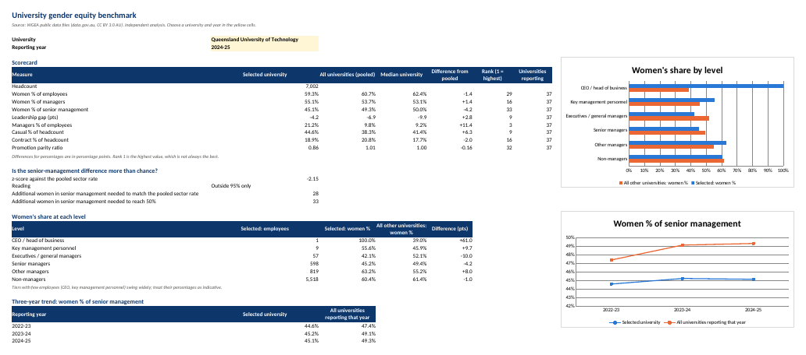
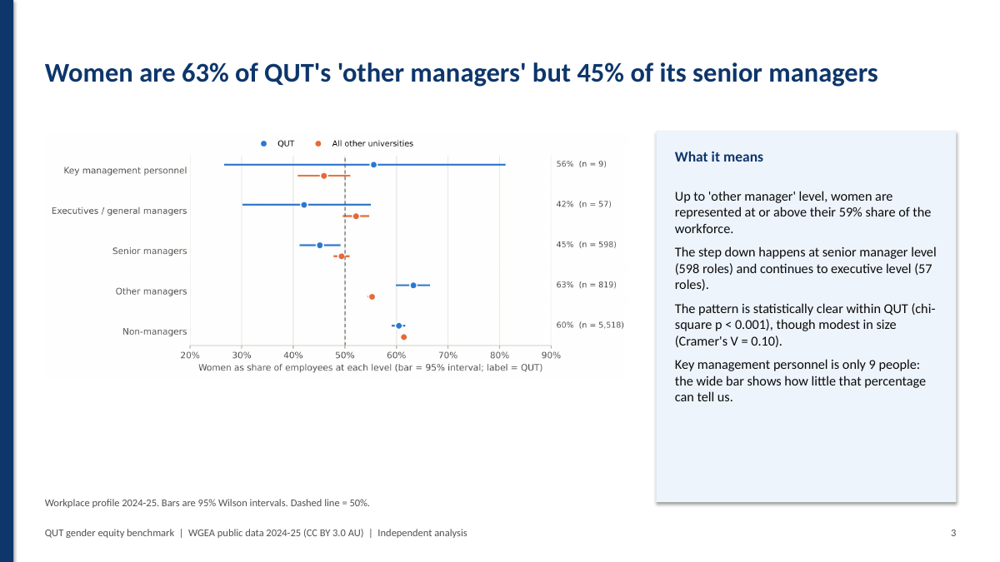
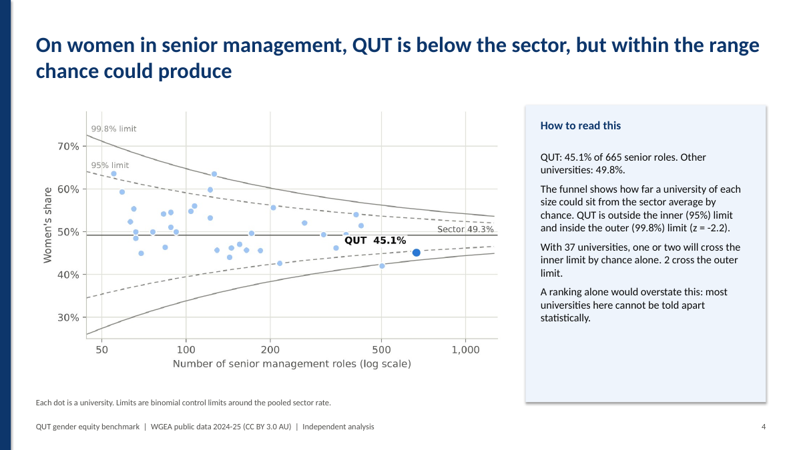

# Women in University Leadership: a sector benchmark

How does one Australian university compare with the rest of the sector on gender equity in
its workforce, and how much of the difference is real?

This project benchmarks **Queensland University of Technology (QUT)** against 36 other
Australian universities using the public data every large employer reports to the
Workplace Gender Equality Agency (WGEA). It delivers an Excel benchmarking workbook, a
PowerPoint briefing and a reproducible analysis.

> **Real, public data.** Source: WGEA public data files for 2022-23 to 2024-25, published on
> [data.gov.au](https://data.gov.au/data/dataset/wgea-dataset) under Creative Commons
> Attribution 3.0 Australia. This is an independent analysis. It is not affiliated with or
> endorsed by QUT, WGEA or any university named, and it describes patterns in reported data,
> not the reasons for them.



## What I found

| | Finding | Evidence |
|---|---|---|
| 1 | **Women are well represented among QUT's managers, until the senior tier.** | Women are 59% of employees, 63% of "other managers", 45% of senior managers and 42% of executives. Chi-square p < 0.001; Cramer's V = 0.10 (small). |
| 2 | **On women in senior management QUT sits below the sector, but not conclusively.** | 45.1% of 665 roles against 49.8% elsewhere: 4.6 points lower (95% CI 0.6 to 8.6), rank 33 of 37. On a funnel plot QUT is outside the 95% limits and inside the 99.8% limits. |
| 3 | **The gap has widened because the sector moved.** | QUT 44.6% to 45.1% over three years; sector 47.3% to 49.2%. |
| 4 | **A bad-looking promotion year is noise.** | 2024-25 parity ratio 0.86 (rank 32 of 37). Pooled over three years and 585 promotions: 0.95, consistent with parity (p = 0.18). |
| 5 | **The comparison has a real weakness, and it matters.** | Universities report between 3% and 23% of staff as managers. QUT reports 21%, more than twice the median. "Senior management" is not the same set of roles everywhere. |

Finding 5 is the one I would lead with in a room. A league table built from this data looks
authoritative and is easy to produce, but most of the universities in it cannot be told apart
statistically, and the categories are defined differently by each employer. The useful
output is narrower: one internal pattern that holds regardless of the comparison (finding 1)
and a short list of questions the public data cannot answer.

Full write-up: [`outputs/key_findings.md`](outputs/key_findings.md).

## The deliverables

| File | What it is |
|---|---|
| [`outputs/University_Benchmark.xlsx`](outputs/University_Benchmark.xlsx) | **Pick any university and year from a drop-down** and the whole workbook re-benchmarks: scorecard against the pooled sector and the median, rank, a z-score "is this more than chance?" reading, tier breakdown and three-year trend. All live formulas (`SUMIFS`, `INDEX/MATCH`, `RANK`, `MEDIAN`, conditional formatting, data validation) over two tidy data sheets. |
| [`outputs/University_Benchmark_Briefing.pptx`](outputs/University_Benchmark_Briefing.pptx) | 9-slide briefing for a non-technical audience. Each slide: the finding as the headline, one chart, and what it means. |
| [`outputs/key_findings.md`](outputs/key_findings.md) | One-page written summary. |
| [`outputs/league_table.csv`](outputs/league_table.csv) | All 37 universities with every metric and its statistical signal. |
| [`docs/methodology.md`](docs/methodology.md) | Source, cleaning decisions, definitions, methods and limitations. |




## Data problems found and handled

Public data is not clean data. Each of these would have changed a headline number:

- **Double counting.** The 2022-23 movements file includes 1,880 subtotal rows alongside their
  components. Summing the file as published overstates higher-education appointments by 233,109.
- **Schema drift.** Column names and category labels change between years (`primary_abn` vs
  `employer_abn`, `Manager` vs `Managers`, a misspelt `Promtions`).
- **A category that exists in one year only.** "Promotions from non-manager to manager" appears
  in 2024-25 alone, so it is excluded from promotion counts to keep years comparable.
- **Who is a university?** The Higher Education industry class holds 80 employers, including
  pathway colleges, medical colleges and subsidiaries. 38 are universities; 37 reported in 2024-25.
- **An unbalanced panel.** Two universities are missing a year. Trends use the 36 that report
  in all three, so the sector line is not moved by who enters or leaves.
- **Small numbers.** One university's annual promotions, or its nine key management
  personnel, cannot support a percentage on their own. Intervals are shown and years pooled.

## Run it

```bash
pip install -r requirements.txt
python run_pipeline.py            # rebuild outputs from the committed extract
python run_pipeline.py --fetch    # or re-download the source files from data.gov.au first (~170 MB)
pytest                            # 16 tests, including Excel-to-Python reconciliation
```

To benchmark a different university, change `FOCUS` in `src/benchmark/config.py`, or just use
the drop-down in the workbook.

## Skills demonstrated

| Skill | Where to look |
|---|---|
| HR metrics and sector benchmarking | `src/benchmark/metrics.py`, `docs/methodology.md` |
| Microsoft Excel | `outputs/University_Benchmark.xlsx` |
| Communicating analysis to non-specialists | `outputs/University_Benchmark_Briefing.pptx` |
| Statistical analysis | Two-proportion test, chi-square, exact binomial test, Wilson intervals, funnel plot |
| Working with messy real-world data | `src/benchmark/fetch.py`, `src/benchmark/data.py`, `tests/test_data.py` |
| Judgement about what data can and cannot show | Finding 5, slide 7, limitations |
| Equity and diversity reporting | The whole project; next steps on slide 8 |

## Limitations

- Manager categories are employer-defined (see finding 5).
- The public files report women and men only. Non-binary employees are not in them.
- No academic level, age, pay, or Aboriginal and Torres Strait Islander status, so the
  questions that matter most for a university's equity strategy need internal data.
- Headcount includes casuals and reflects each employer's snapshot date.
- Three years is a direction, not a trend.

## Tech

Python 3.12 (pandas, statsmodels, scipy, matplotlib, openpyxl, python-pptx), pytest, GitHub Actions.
