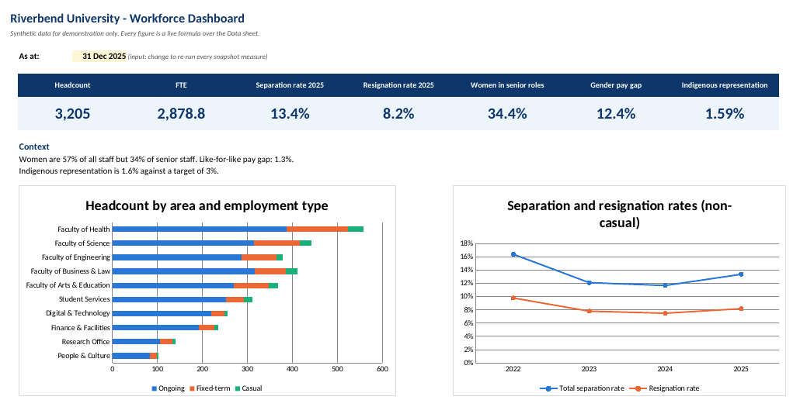
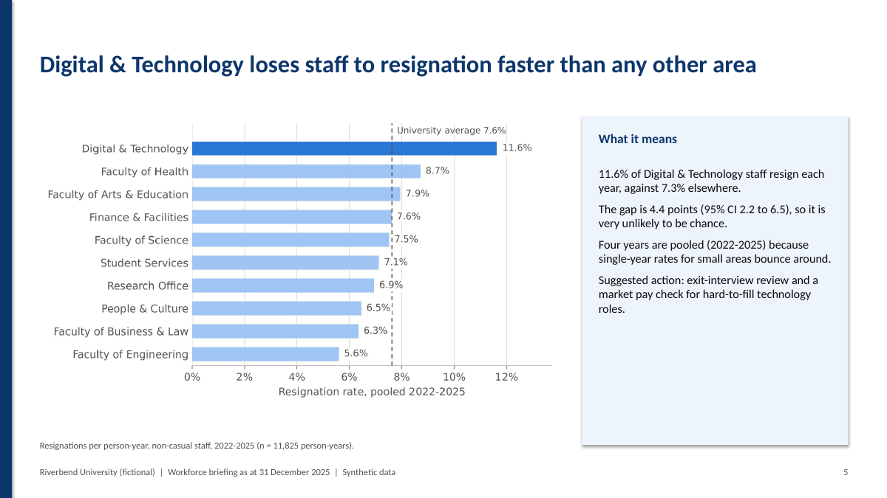
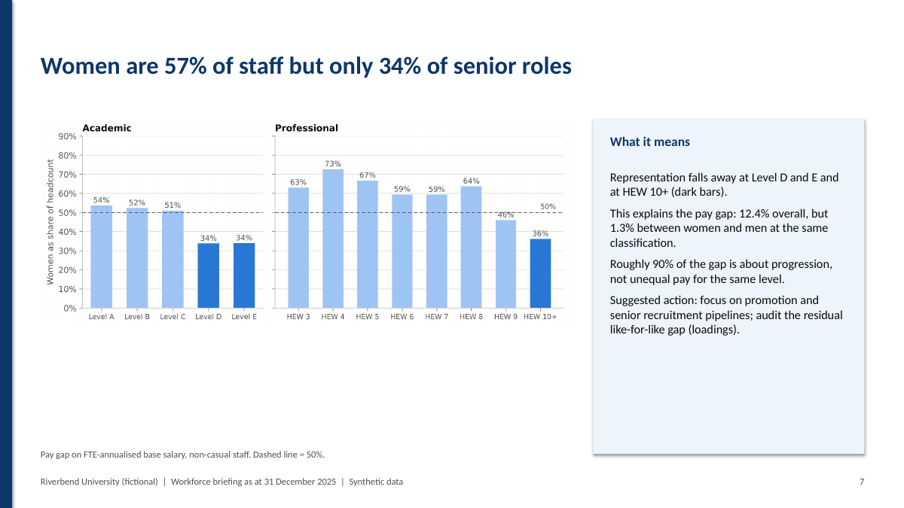

# University Workforce Analytics

An end-to-end workforce reporting and analysis project for a (fictional) Australian university:
from a messy HR system extract to an Excel report, a statistical analysis, and a ten-minute
executive briefing in PowerPoint.

> **All data is synthetic.** "Riverbend University" does not exist and no real people are
> represented. The dataset is simulated so the whole project can be shared publicly.



## The question

*A university's HR leadership wants to know: what does our workforce look like, where are we
losing people, and how are we tracking on gender equity and Aboriginal and Torres Strait Islander
employment?*

## What I found

| | Finding | Evidence |
|---|---|---|
| 1 | **Resignations are concentrated, not general.** Fixed-term staff, people in their first two years, and Digital & Technology staff are each markedly more likely to resign. Gender and academic/professional group make no significant difference. | Logistic regression: odds ratios 1.68, 1.38 and 1.70. Digital & Technology resigns at 11.6% a year vs 7.3% elsewhere (difference 4.4 pts, 95% CI 2.2 to 6.5). |
| 2 | **The gender pay gap is about seniority, not unequal pay for the same job.** | Overall gap 12.4%; at the same classification 1.3%. Women are 57% of staff but 34% of senior roles. |
| 3 | **Indigenous representation will not reach its target on the current path.** | 1.6% of headcount (95% CI 1.2% to 2.1%) against a 3% target. At the current hiring mix the target is not reached in 10 years; at 5% of hires it takes about 4. |
| 4 | **One faculty faces a retirement wave.** | 14% of ongoing Engineering staff reach 65 within five years: double the university rate. |

Full write-up with every number: [`outputs/key_findings.md`](outputs/key_findings.md).

## The deliverables

| File | What it is | Audience |
|---|---|---|
| [`outputs/Workforce_Report.xlsx`](outputs/Workforce_Report.xlsx) | Excel report: dashboard, headcount, turnover, equity and a what-if scenario model. **Every figure is a live formula** (`COUNTIFS`, `SUMIFS`, `AVERAGEIFS`, `SUMPRODUCT`, `INDEX/MATCH`) over the data sheet, with input cells and a year selector. | HR partners, analysts |
| [`outputs/Workforce_Briefing.pptx`](outputs/Workforce_Briefing.pptx) | 11-slide briefing. Each slide: a headline that states the finding, one chart, and a plain-English "what it means / what to do" panel. | Senior leaders |
| [`outputs/key_findings.md`](outputs/key_findings.md) | One-page written summary. | Anyone |
| [`outputs/data_quality_log.csv`](outputs/data_quality_log.csv) | Audit trail of every data correction. | Data owners |
| [`docs/methodology.md`](docs/methodology.md) | Metric definitions, statistical methods, privacy rules, limitations, data dictionary. | Analysts, auditors |




## How it works

```
data/raw/employees_raw.csv        5,555 rows, with realistic data-entry errors
        |  clean.py                11 validation rules; every fix logged
data/processed/employees_clean.csv
        |  metrics.py / stats.py   one definition per metric; tests and models
        |
        +--> excel_report.py  ->  Workforce_Report.xlsx    (live formulas)
        +--> charts.py + deck.py -> Workforce_Briefing.pptx
        +--> analysis.py      ->  key_findings.md, tables/
```

One command rebuilds everything:

```bash
pip install -r requirements.txt
python run_pipeline.py
pytest
```

## Things I paid attention to

**Attention to detail.** The raw extract contains duplicates, transposed dates, salaries keyed
with an extra zero, inconsistent labels and missing values. Each is caught by a named rule,
fixed or flagged, and logged. An off-by-one in "who is employed on the snapshot date" changes
turnover; the rule is written down and tested.

**Numbers that agree with each other.** The Excel workbook and the Python analysis are
independent implementations of the same definitions. An automated test recalculates the
workbook and checks that all its figures reconcile to Python. Slide text is generated from
the results, so the deck cannot quote a stale number.

**Honest statistics.** Confidence intervals are shown wherever a rate rests on a small group.
Effect size is reported alongside significance (the employment-type effect is real but small:
Cramer's V = 0.08). Division rates pool four years because single-year rates for small areas
are noise. The regression is described as association, not cause.

**Privacy and respect in equity reporting.** Counts under five are suppressed. Indigenous and
non-binary results are reported at university level only, since any breakdown would identify
individuals. Staff who have not disclosed their status stay in the denominator, and the
non-disclosure rate is reported so readers know the figure is a floor. Recommendations on
Indigenous employment are framed as work to be designed with Indigenous staff and leadership,
not for them.

**Writing for the audience.** The same result is expressed three ways: an odds ratio with a
clustered-standard-error footnote for analysts, "1.7 times the odds" for HR partners, and
"Digital & Technology loses staff faster than any other area" for executives.

## Skills demonstrated

| Skill | Where to look |
|---|---|
| HR metrics and workforce reporting | `src/workforce/metrics.py`, `docs/methodology.md` |
| Microsoft Excel | `outputs/Workforce_Report.xlsx` (formulas, data validation, charts, what-if model) |
| Microsoft PowerPoint and communicating analysis | `outputs/Workforce_Briefing.pptx` |
| Statistical analysis | `src/workforce/stats.py` (chi-square, two-proportion test, Wilson intervals, logistic regression) |
| Data quality and attention to detail | `src/workforce/clean.py`, `outputs/data_quality_log.csv`, `tests/` |
| Problem solving and innovation | Scenario model for the representation target; automated Excel-to-Python reconciliation |
| Equity, diversity and Indigenous Australian engagement | Equity sheet, slides 7-8, privacy rules in `docs/methodology.md` |

## Limitations

The data is simulated, so the findings illustrate a method rather than describe any real
institution; the patterns found are ones the simulation was designed to contain
(see the methodology for the full list). A real engagement would add things this project
cannot: conversations with stakeholders about what they actually need, exit-interview and
engagement-survey data, and benchmarking against sector data.

## Tech

Python 3.12 (pandas, statsmodels, scipy, matplotlib, openpyxl, python-pptx), pytest,
GitHub Actions.
